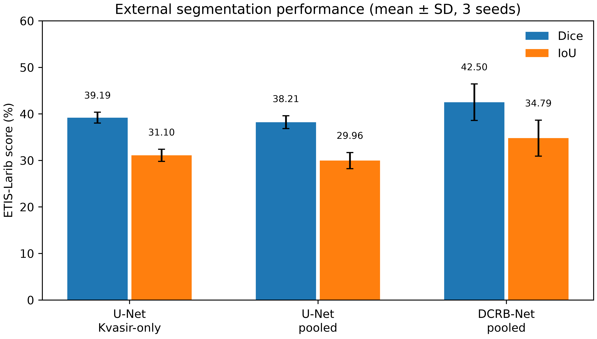
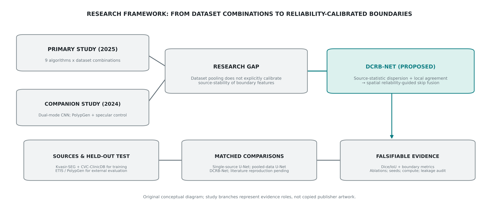
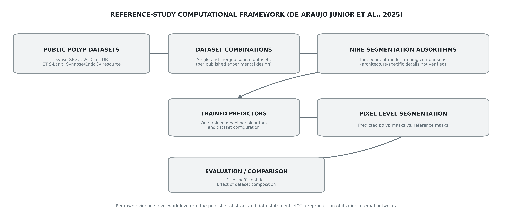
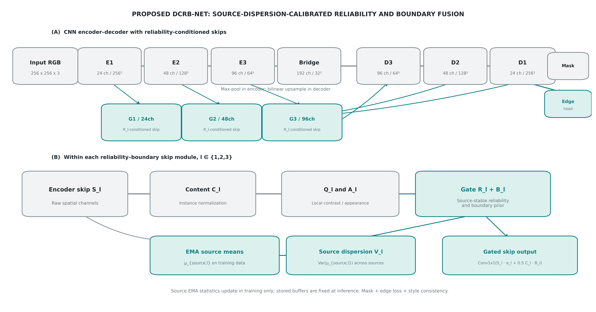
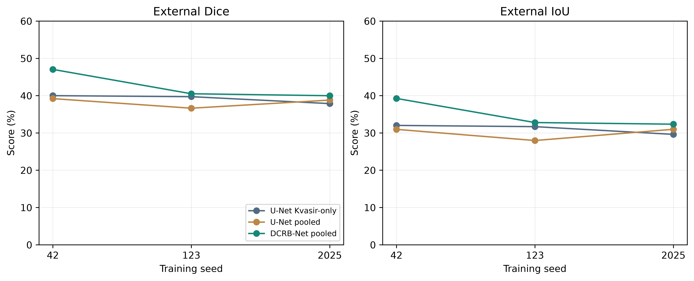
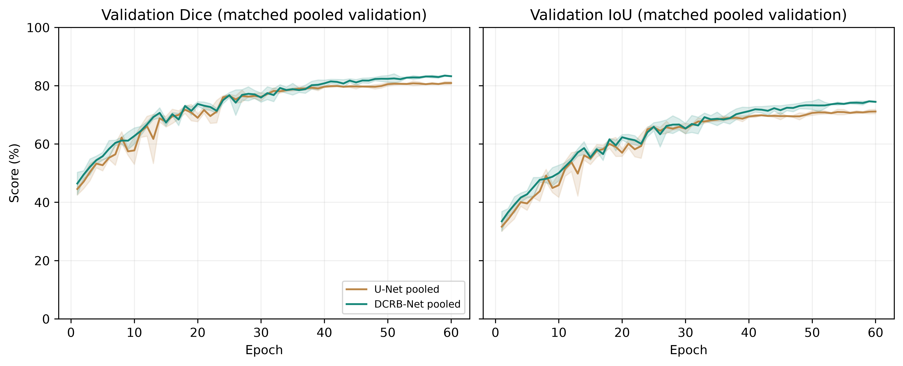
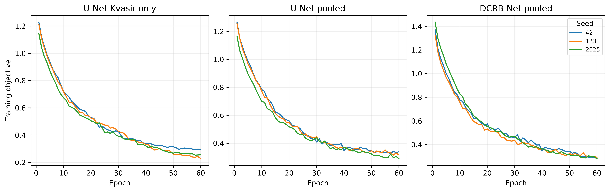
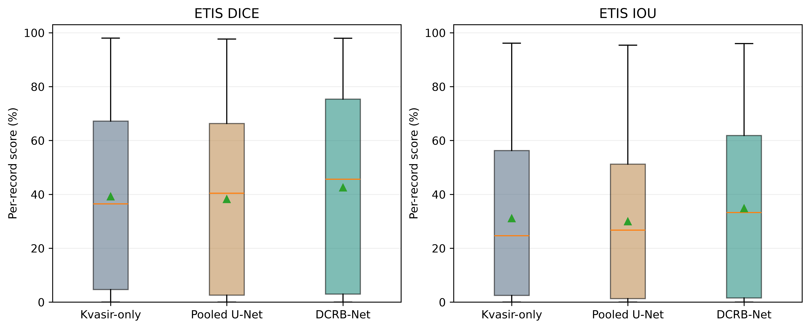
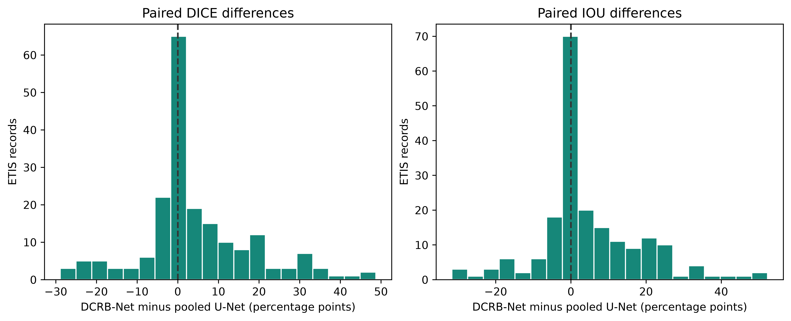

# DCRB-Net
**Domain-Consistency and Reliability-Guided Boundary Fusion for Cross-Dataset Colorectal Polyp Segmentation**

Research code and verified experimental evidence accompanying the manuscript prepared for *SN Computer Science*. This repository documents the completed controlled experiment, not a claim of publication or state-of-the-art performance.

**Authors (manuscript):** Agus Perdana Windarto, Sobihatun Nur Abdul Salam, Mesran, Junhai Wang, and Titus Kristanto.

## Research question and contribution

Does source-calibrated reliability-guided skip fusion improve cross-dataset polyp segmentation beyond pooling training datasets alone? DCRB-Net extends a compact U-Net-style encoder–decoder with three ReliabilityBoundarySkip (RBS) modules, source-only exponential moving-average (EMA) feature statistics, spatial reliability and boundary gates, an auxiliary edge head, and photometric prediction consistency. Encoder widths are 24, 48 and 96; bottleneck width is 192. Source statistics are updated only on labeled training sources and frozen at validation and inference. Reliability is a feature-weighting signal, not calibrated clinical uncertainty.

The principal motivation is de Araujo Junior et al. (2025), [Colorectal polyp segmentation with different dataset combinations](https://doi.org/10.1007/s42979-025-04177-w). The target-journal companion study is Sushama and Menon (2024), [Flexible colon polyp detection: A dual mode approach](https://doi.org/10.1007/s42979-024-02932-z). Neither study's full comparator suite is reproduced here; their published scores must not be treated as matched measurements.

## Research framework

1. Audit dataset provenance, pair identities and exact file hashes.
2. Create fixed source-wise training/validation partitions; reserve ETIS-Larib entirely for external evaluation.
3. Train U-Net Kvasir-only, U-Net pooled, and DCRB-Net pooled under the same optimizer-update budget and seeds.
4. Select checkpoints by validation Dice only; evaluate frozen checkpoints on ETIS-Larib.
5. Aggregate per-image Dice/IoU across three seeds. Compare the data-pooling contrast and architecture contrast separately.

## Data and partitions

| Dataset | Total | Train | Validation | External test |
|---|---:|---:|---:|---:|
| Kvasir-SEG | 1,000 | 800 | 200 | 0 |
| CVC-ClinicDB | 612 | 489 | 123 | 0 |
| ETIS-Larib | 196 | 0 | 0 | 196 |
| Total | 1,808 | 1,289 | 323 | 196 |

U-Net Kvasir-only uses 800 training and 200 validation images; both pooled arms use 1,289 training and 323 validation images. All nine runs use the same 196 external ETIS records. Source-wise image-level 80:20 splits use split seed 2025. The training seed does not change the split. Exact-byte cross-split duplicate checking passed; patient/video independence and perceptual near-duplicate exclusion remain unverified. ETIS contains 193 unique image hashes among 196 records, so the 196-record evaluation should not be represented as 196 independent patients.

Source mounts: [Kvasir-SEG](https://www.kaggle.com/datasets/ipythonx/kvasirseg), [CVC images](https://www.kaggle.com/datasets/doansang/cvc-clinicdb), [ETIS-Larib](https://www.kaggle.com/datasets/nguyenvoquocduong/etis-laribpolypdb). The public CVC mirror is used for **images only**; correct expert masks and original SHA256 manifest are provided through a restricted research-only CVC dataset. Obtain authorized access from the study team and respect source dataset terms. Raw images, private masks, credentials and machine-specific paths are intentionally excluded. The path-stripped public manifests are audit derivatives, not byte-identical copies of the private original manifest.

## Experimental protocol

| Item | Executed setting |
|---|---|
| Input and mask | RGB 256 × 256, bilinear image / nearest-neighbor mask resize; mask threshold ≥127 |
| Training seeds | 42, 123, 2025 |
| Optimizer | AdamW, learning rate 2e-4, weight decay 1e-4 |
| Batch and budget | Batch 8; 100 optimizer batches per epoch for each arm |
| Epochs and selection | Maximum 60; early-stopping patience 10; best validation Dice |
| LR scheduler | ReduceLROnPlateau, factor 0.5, patience 3 |
| Augmentation | Paired random horizontal/vertical flips |
| Baseline loss | BCEWithLogits + soft Dice loss |
| Proposed loss | Baseline loss + 0.20 boundary BCE + 0.10 photometric consistency every fourth mini-batch |
| EMA | 0.05; training-source mean stored in FP32 |
| Evaluation | Mean per-image Dice and IoU, sigmoid probability >0.5 |
| Checkpoint | Atomic latest state every 10 batches and epoch boundary; best state by validation Dice |

Each pooled epoch draws a deterministic shuffled subset of 800 training observations, rather than traversing all 1,289 images, to match the baseline's optimizer-update budget. The proposed consistency term adds an auxiliary forward pass; equal optimizer updates do not imply equal FLOPs. Training used Kaggle CUDA/Tesla T4, with original source notebook preserved. Proposed runs use the AMP/EMA dtype correction and pass an on-GPU regression check.

## Verified results — 9/9 runs

All values below are percentages, mean ± sample standard deviation across seeds (not confidence intervals).

| Model | Validation Dice | Validation IoU | ETIS Dice | ETIS IoU |
|---|---:|---:|---:|---:|
| U-Net Kvasir-only | 79.95 ± 0.86 | 69.84 ± 1.04 | 39.19 ± 1.16 | 31.10 ± 1.30 |
| U-Net pooled | 81.03 ± 0.62 | 71.16 ± 0.80 | 38.21 ± 1.39 | 29.96 ± 1.73 |
| **DCRB-Net pooled** | **83.52 ± 0.16** | **74.69 ± 0.17** | **42.50 ± 3.93** | **34.79 ± 3.87** |



Compared with pooled U-Net, DCRB-Net improves mean external Dice by **4.29 percentage points** and mean external IoU by **4.83 points**. The external Dice improvement is observed for all three seeds, but cross-seed dispersion increases. Pooling alone changes mean external Dice by −0.98 points relative to the single-source control. The single-source validation set differs from the pooled validation set; direct comparisons between those internal validation averages are not equivalent. No statistical significance, clinical readiness, or component-specific causal effect is claimed.

### Per-seed external Dice (%)

| Model | Seed 42 | Seed 123 | Seed 2025 |
|---|---:|---:|---:|
| U-Net Kvasir-only | 40.00 | 39.72 | 37.86 |
| U-Net pooled | 39.20 | 36.63 | 38.80 |
| DCRB-Net pooled | 47.03 | 40.50 | 39.98 |

Full-precision data: [per-seed CSV](results/per_seed.csv), [aggregate CSV](results/aggregate.csv), [all metrics JSON](results/DCRB_FINAL_AGGREGATE_9_RUNS.json), and [run provenance](results/run_index.json).

## Full per-seed evaluation

| Model | Seed | Validation Dice (%) | Validation IoU (%) | ETIS Dice (%) | ETIS IoU (%) |
|---|---:|---:|---:|---:|---:|
| U-Net Kvasir-only | 42 | 78.96 | 68.65 | 40.00 | 32.01 |
| U-Net Kvasir-only | 123 | 80.55 | 70.55 | 39.72 | 31.68 |
| U-Net Kvasir-only | 2025 | 80.32 | 70.32 | 37.86 | 29.61 |
| U-Net pooled | 42 | 80.57 | 70.58 | 39.20 | 30.95 |
| U-Net pooled | 123 | 80.79 | 70.84 | 36.63 | 27.96 |
| U-Net pooled | 2025 | 81.74 | 72.07 | 38.80 | 30.97 |
| DCRB-Net pooled | 42 | 83.36 | 74.54 | 47.03 | 39.25 |
| DCRB-Net pooled | 123 | 83.69 | 74.87 | 40.50 | 32.78 |
| DCRB-Net pooled | 2025 | 83.51 | 74.66 | 39.98 | 32.34 |

Each value is a mean over the corresponding validation or external records. The pooled validation comparisons share the same 323 records; the Kvasir-only validation results use 200 records. The external comparison uses identical 196 ETIS records for every run.

## Visual evidence and figure guide

All nine figures below are included in PNG and SVG format; the six numerical plots are generated from recorded experimental outputs. The three method diagrams are original study schematics, not measured performance. Their original filenames predate the manuscript's final figure numbering.

### A. Research framework and architecture (manuscript Figs. 2–4)



**Manuscript Fig. 2 — Research framework.** The principal and companion studies motivate the research gap, followed by proposed reliability-guided fusion, controlled experiments and external evaluation. PolypGen, boundary metrics, ablations and efficiency appearing in this planning diagram are proposed extensions, not completed results. [SVG](figures/Fig1_Research_Framework_DCRB.svg).



**Manuscript Fig. 3 — Primary reference pipeline.** Conceptual redrawing of the reference study's dataset-combination and algorithm-comparison process. This is not a reconstruction of its individual networks or an executed nine-algorithm reproduction. [SVG](figures/Fig2_Primary_Reference_Study_Pipeline.svg).



**Manuscript Fig. 4 — Proposed DCRB-Net.** Encoder–decoder with three source-statistic-calibrated ReliabilityBoundarySkip modules, segmentation and auxiliary edge heads, and training-only source EMA updates. [SVG](figures/Fig3_Proposed_DCRB_Net_Architecture.svg).

Manuscript Fig. 1 (dataset examples) is retained in the local research archive. It contains original medical-image and annotation pixels; redistribution permissions for these examples have not yet been documented. No private CVC masks or raw dataset images are redistributed here.

### B. Quantitative results

**External comparison.** The mean ± sample SD chart shown in the verified-results section compares Dice and IoU on identical ETIS records. [PNG](figures/etis_comparison.png) · [SVG](figures/etis_comparison.svg).



**External performance across seeds.** DCRB-Net exceeds pooled U-Net in both overlap metrics for each seed; seed 42 has the strongest DCRB-Net external result. Lines connect categorical seed labels for readability, not a temporal trend. [SVG](figures/etis_per_seed.svg).



**Validation learning curves.** Epoch-wise mean ± sample SD across three seeds on the same 323 pooled validation records. The band represents seed dispersion, not a confidence interval. Checkpoint selection is based on validation Dice, not ETIS. [SVG](figures/pooled_validation_curves.svg).



**Training objective trajectories.** All nine histories are shown in three model-specific panels. The proposed loss includes edge supervision and intermittent consistency regularization; its absolute training objective is not directly comparable to the baseline objective. [SVG](figures/training_loss_by_model.svg).



**External per-record distributions.** Boxplots use each ETIS record's average score over three training seeds (196 records per model); markers show means and outliers. This illustrates score heterogeneity rather than assuming independent patients. [SVG](figures/etis_per_image_distribution.svg).



**Paired external improvements and failures.** Seed-averaged DCRB-Net minus pooled U-Net for the same ETIS records: Dice improves on 128, worsens on 63 and ties on 5; IoU improves on 131, worsens on 60 and ties on 5 (numerical tie tolerance 1e-9 percentage points). These are descriptive paired differences, not significance tests. [SVG](figures/etis_paired_differences.svg).

### C. Duplicate-image sensitivity

Three ETIS image pairs share exact image hashes but have different annotations. The primary evaluation keeps all 196 records as originally evaluated. A supplementary sensitivity analysis averages annotation-specific scores within each identical image hash and then weights all 193 distinct hashes equally.

| Model | Dice, 196 records (%) | Dice, 193 hashes (%) | IoU, 196 records (%) | IoU, 193 hashes (%) |
|---|---:|---:|---:|---:|
| U-Net Kvasir-only | 39.19 | 39.08 | 31.10 | 31.08 |
| U-Net pooled | 38.21 | 37.75 | 29.96 | 29.60 |
| DCRB-Net pooled | 42.50 | 42.01 | 34.79 | 34.38 |

The descriptive ranking remains unchanged after equal weighting by unique image hash. This does not establish patient independence or statistical significance. See [duplicate audit](data_audit/ETIS_DUPLICATE_LABEL_AUDIT.md), [per-seed sensitivity CSV](results/etis_duplicate_sensitivity.csv), and [descriptive summary JSON](results/etis_descriptive_summary.json).

### D. Qualitative segmentation evidence — pending

The verified run artifacts contain per-image Dice and IoU but no exported prediction masks or contour overlays. Actual original-image/ground-truth/prediction panels require inference using the validation-selected checkpoints and authorized data access; no synthetic or illustrative masks are substituted. Boundary F-score, surface distances, ablations, matched contemporary comparators and computational efficiency remain unevaluated. These limits are retained explicitly for manuscript preparation.

To regenerate the additional evaluation plots and sensitivity analysis, run the script [plot_extended_results.py](scripts/plot_extended_results.py).

## Repository layout and reproducibility

- `notebooks/`: nine exact executed-configuration notebooks and kernel metadata plus the preserved reference notebook.
- `results/runs/`: original per-image metrics, history, run configuration, preflight, metric JSON, original artifact checksum ledger and local verification report for each run.
- `data_audit/`: path-stripped source hash manifest, verified hash mapping, fixed split assignments and audit summary.
- `checkpoints/`: original validation-selected best checkpoints for the nine runs. Latest resume checkpoints remain in the local research archive; their SHA256 values are retained in the run index and original artifact ledgers. Checkpoints contain Python-serialized training state; only load from a trusted source after checking SHA256. Do not load arbitrary pickle files.
- `figures/`: plots generated from verified numerical results, not synthetic prediction examples.
- `scripts/`: independent result verification and plot generation.
- `references/`: manuscript bibliography.

To reproduce a run, create an authorized private Kaggle notebook, attach the four dataset sources specified in its kernel metadata, enable CUDA GPU, disable internet, and run the notebook for the chosen seed. A full SHA256 preflight must pass before training. The original research notebook is a reference, not the final Kaggle configuration. Baselines were run on `agusperdana`; proposed runs on `niluhwiwiksrirahayu`. Account-specific notebooks are private, and reproduction requires appropriate dataset access. See the run index for exact kernel identifiers.

To verify the published result evidence without GPU or data downloads:

```bash
python scripts/verify_results.py
```

To regenerate the plots, install matplotlib and run `python scripts/plot_results.py`.

## Scope and outstanding evidence

The completed study covers three controlled architectures × three training seeds, with held-out ETIS evaluation. The manuscript also plans source-statistic, reliability, boundary and photometric-consistency ablations; boundary-sensitive metrics; efficiency measurements; prediction-mask panels; additional matched literature comparators and optional PolypGen testing. These are **not claimed as completed**. Patient/video-grouped splits and near-duplicate audits require additional evidence; inferential statistics have not been established. Published benchmark outcomes obtained under incompatible conditions should remain separate. This repository documents research prototypes, not clinical deployment software.

## References and access

- de Araujo Junior et al. (2025), SN Computer Science 6, 678. DOI: 10.1007/s42979-025-04177-w.
- Sushama and Menon (2024), SN Computer Science 5, 641. DOI: 10.1007/s42979-024-02932-z.
- Bernal et al. (2015), Computerized Medical Imaging and Graphics 43, 99–111. DOI: 10.1016/j.compmedimag.2015.02.007.
- Ali et al. (2023), Scientific Data 10, 75. DOI: 10.1038/s41597-023-01981-y.

See [bibliography](references/DCRB_Net_References.bib). Dataset ownership and terms remain with the original providers; no license for redistributing restricted medical images or annotations is granted by this repository. The manuscript is in preparation.
